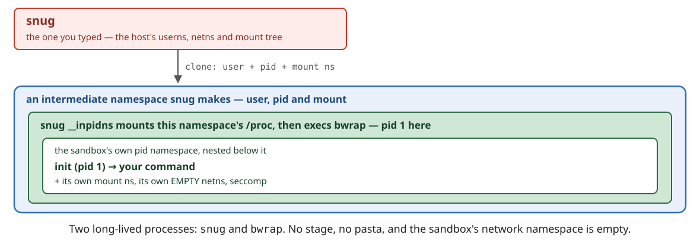
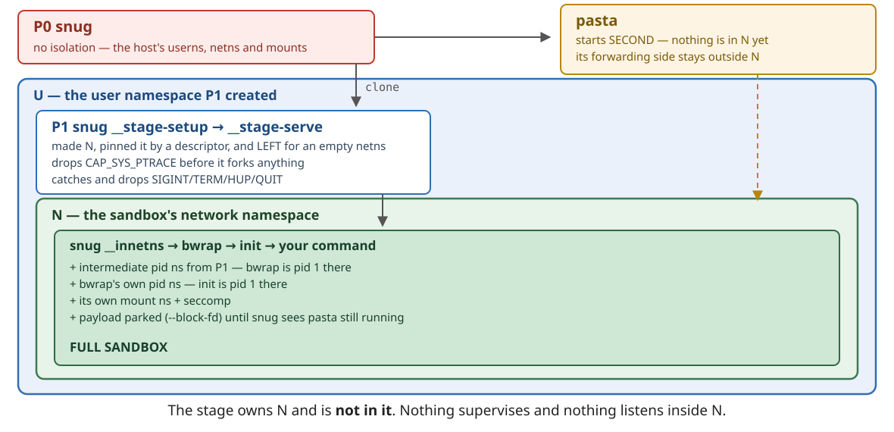
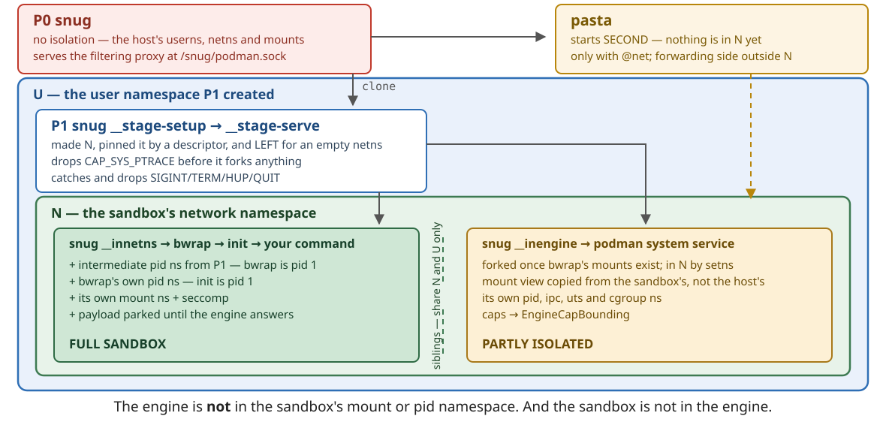

# The architecture

> I started the project because I thought it would be easy.

The precursor to `snug` was the script `agent-sandbox.sh`, because what could
be easier than developing a sandbox? Docker was the first roadblock, and such a
trivial sandbox escape that it was not funny. Less stubborn people would
have given up at that exact moment.

The script was converted to Go, because developing a `bwrap` executor and a
docker filtering proxy in Go is easy and can be done with the standard library
only. Then came embedded podman, fighting Linux syscalls that expect to be
called from a single thread, and the fact that podman runs in a sibling sandbox
with more privileges, sharing the network namespace.

## Go without cgo

`snug` itself is a single statically linked binary, which re-executes itself
several times to provide the stages needed to build a sandbox. The HTTP door
and the login bridge also run it inside the sandbox, where no libc or loader is
granted. This is the reason for a strict `CGO_ENABLED=0` policy. In fact,
`snug` fails to build with cgo enabled
([`cmd/snug/nocgo.go`](https://github.com/gomoni/snug/blob/main/cmd/snug/nocgo.go)).

If `snug` used cgo, it would be linked against a specific libc, so there would
have to be a glibc build and a musl build. A static Go binary runs anywhere,
including inside a distrobox or a CI container or severely restricted Linux
user space.

The in-depth story, with measurements made by Claude, is in
[`NOCGO.md`](https://github.com/gomoni/snug/blob/main/.claude/design/NOCGO.md).

## Single-threaded Linux syscalls

While Go itself is a nice language, very handy for things like a filtering docker
proxy or ssh-agent proxy, it is not compatible with traditional C-based Linux
environments. In fact Go's underlying model from memory layout up to mandatory
runtime is as anti-C as it can be.

Some Linux syscalls do not like being run from a multithreaded environment.
`setns(2)` into a mount or a user namespace fails with `EINVAL` when the
calling process has more than one thread. So `snug` never joins a mount or a
user namespace. It lets `bwrap` create them. `runc`, the runtime behind docker, and `podman` solve it with C
code run before Go starts, which needs cgo.

A network namespace can be joined from a multithreaded process, but `setns(2)`
itself moves only the calling thread. In order to solve this in Go, `snug`
locks the OS thread, calls `setns` and then executes `bwrap` inside this
namespace.

```go
func enterNetns(fd int, bwrap string, args []string) error {
	// setns moves only this thread, so keep the goroutine on it
	runtime.LockOSThread()
	if err := unix.Setns(fd, unix.CLONE_NEWNET); err != nil {
		return err
	}
	// execve replaces the process with this thread and its namespace
	return syscall.Exec(bwrap, append([]string{bwrap}, args...), []string{})
}
```

See
[`internal/stage/innetns.go`](https://github.com/gomoni/snug/blob/main/internal/stage/innetns.go).

## The plain shape — no network



## With `@net` — one more process, and it is the point

Each sandbox has its own network namespace, which is not connected to the host
network. To enable network communication, `snug` uses `pasta`, the same
component powering rootless podman, which connects the host network namespace
with the sandbox's. The network namespace must exist _before_ the sandbox, so
`snug` creates it first in a helper process, the stage. This increases the
number of processes snug executes.



## Sandboxed podman engine

`snug` is probably the only program that sandboxes the container engine itself.
The reason is that its goal is to hide the host from the sandbox. Traditional
engines like `dockerd` or the host's `podman system service` need elevated
privileges or access to the host filesystem, and as such allow the sandboxed
processes to reach the host.

At the same time, containerized development is useful and often mandatory. So
`snug` can run a `podman` engine in a sibling sandbox, which shares the same
network namespace. This closes another escape, where an offline sandbox with a
docker socket could still reach the network through the host's docker.

The sandboxed engine is exposed as `/snug/podman.sock`, and all communication is
filtered through `dockerproxy`, which refuses every operation that would reach
what the main sandbox itself cannot.



## What dies when

Ctrl-C reaches your command, which gets up to 1s to exit. snug then reports
its exit code. If it is still running after that, snug kills it and exits with
128 plus the signal number, 130 for Ctrl-C. Press Ctrl-C again to stop
waiting. `kill -TERM snug` works the same way.

When snug exits, normally or abruptly, everything it started dies with it. That
includes the re-executed snug processes, pasta, bwrap and the sandboxed
command. There is no `snug stop`, nothing to clean up and no pid files
to remove.
